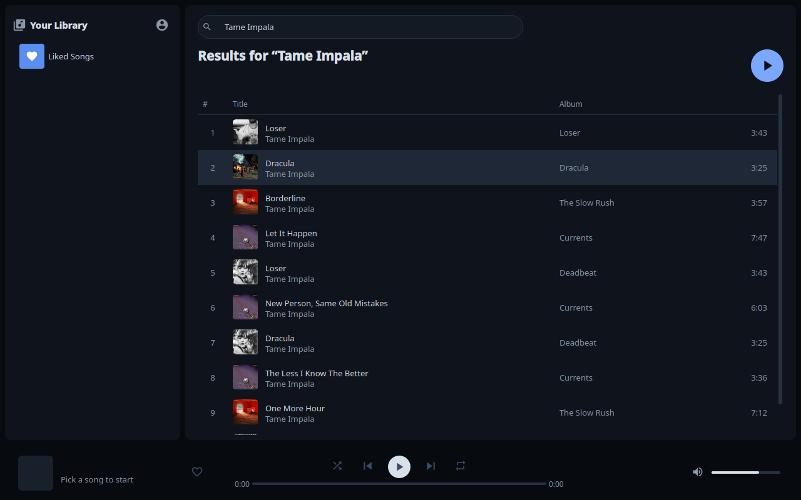
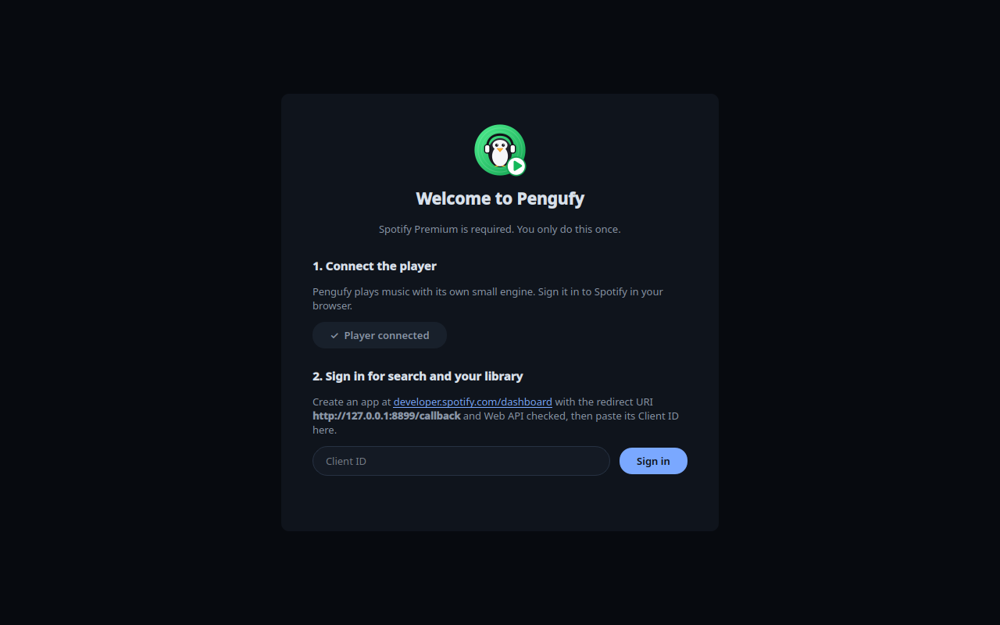

<p align="center"></p>

<h1 align="center">Pengufy</h1>

<p align="center">A simple, single-page Spotify player for Linux.</p>

Pengufy keeps Spotify down to the basics: one window with a search box, your library on the left and a player bar
at the bottom. Sound comes from a small built-in engine ([spotifyd](https://github.com/Spotifyd/spotifyd)), so the
official Spotify app doesn't need to run. It uses about 30 MB of memory instead of several hundred.

<p align="center"></p>

> Pengufy is an unofficial app. It is not affiliated with or endorsed by Spotify.
> **Spotify Premium is required** (for both the engine and Spotify's developer API).

## Features

- Search songs (scroll down for more results)
- Liked Songs and your playlists
- Like / unlike the current song
- Play, pause, next, previous, seek, shuffle, repeat, volume
- Media keys and the desktop's media controls (through the engine's MPRIS support)
- Keyboard: `Ctrl+F` search, `Ctrl+Space` play/pause, `Ctrl+←/→` previous/next

## Install

You need PyQt6 and python `requests` from your distro (the installer tells you the exact command if one is missing):

```sh
git clone https://github.com/hTulu07/pengufy
cd pengufy
./install.sh
```

The installer downloads spotifyd from its GitHub release, checks its SHA-512 checksum and installs everything
into `~/.local`. No root is needed. To remove it, run `./uninstall.sh` (add `--purge` to also delete your sign-in).

## First start

1. **Connect the player:** click *Connect player* and allow access in your browser. This signs the engine in.
2. **Sign in for search and your library:** since February 2026, Spotify only allows personal apps to use its API
   with your own *Client ID*:
   1. Open the [Spotify developer dashboard](https://developer.spotify.com/dashboard) and click **Create app**.
   2. Add the redirect URI `http://127.0.0.1:8899/callback` (exactly like this) and tick **Web API**.
   3. Copy the **Client ID** into Pengufy and click **Sign in**. You never need the Client Secret.

<p align="center"></p>

## Limits

These come from Spotify's rules for personal (Development Mode) apps:

- Search returns 10 songs per page.
- Song lists are shown only for playlists you own or collaborate on. Other playlists can still be played.

## License

MIT
